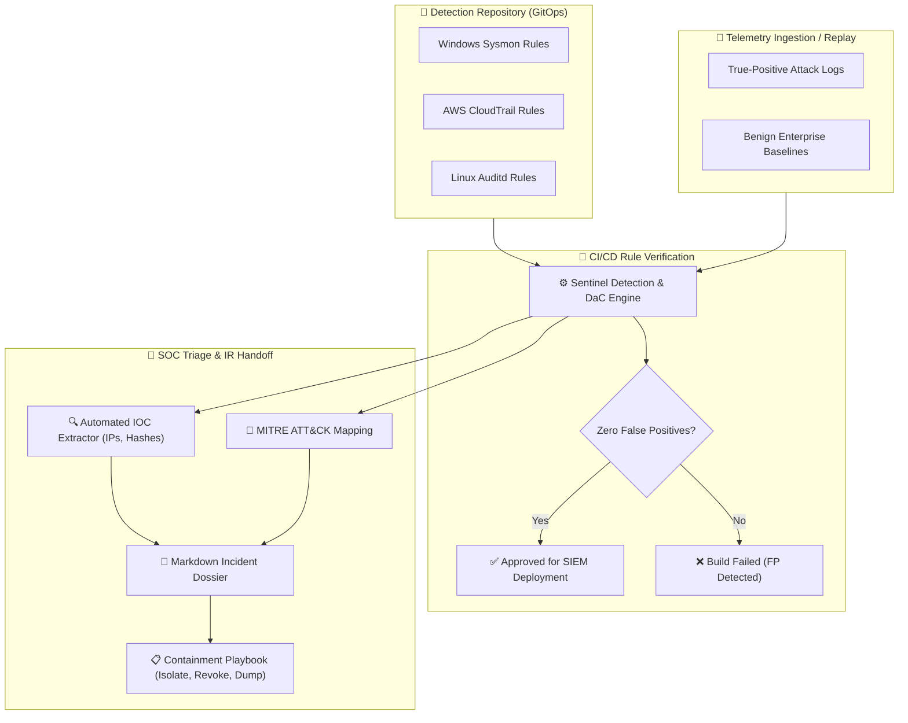

# 🛡️ Sentinel: Detection-as-Code (DaC) & SOC Incident Triage Engine

[](#)
[](https://attack.mitre.org/)
[](https://www.python.org/)
[](LICENSE)

A modular, production-grade **Detection-as-Code (DaC)** engine and **SOC Incident Triage Harness**. Sentinel automates the validation of threat detection rules (Sigma-compatible YAML) against real-world and synthetic telemetry, ensuring zero false-positive leakage into production SIEMs while instantly generating structured incident triage dossiers for Incident Responders.

---

## 🎯 The Problem Sentinel Solves

Security Operations Centers (SOCs) face two major bottlenecks:
1. **Detection Drift & Fragile Rules**: Rules authored directly in SIEM UIs decay over time, lack version control, and trigger alert fatigue due to unvetted false positives.
2. **Slow Incident Handoff (MTTR)**: When an alert fires, Tier 1/2 analysts spend crucial minutes manually correlating MITRE techniques, pulling external IOCs, and determining containment steps.

**Sentinel** solves this with a GitOps Detection-as-Code pipeline:
* **Automated CI/CD Rule Verification**: Every pull request tests detection rules against true-positive attack telemetry and benign baseline datasets before merging.
* **Instant Incident Dossier Generation**: Automatically correlates matched events with MITRE tactics/techniques, extracts network/hash IOCs, and prescribes exact containment playbooks.
* **Multi-Source Support**: Native telemetry replay for **Windows Sysmon**, **AWS CloudTrail**, and **Linux auditd**.

---

## 🏗️ Architecture



---

## 🎯 MITRE ATT&CK® Coverage

| Technique ID | Technique Name | Tactic | Log Source | Severity |
| :--- | :--- | :--- | :--- | :--- |
| **T1059.001** | PowerShell Download Cradle | Execution / C2 | Windows Sysmon | `HIGH` |
| **T1078.004** | Cloud Root Login Without MFA | Initial Access / Privilege Escalation | AWS CloudTrail | `CRITICAL` |
| **T1003.008** | Unauthorized `/etc/shadow` Access | Credential Access | Linux Auditd | `HIGH` |

---

## ⚡ Quickstart

### 1. Test Detection Rules in CI/CD
Verify all detection rules against attack datasets and benign baselines:

```bash
# Clone the repository
git clone https://github.com/koushik0011/sentinel-detection-engine.git
cd sentinel-detection-engine

# Run rule validation harness
export PYTHONPATH=src
python -m sentinel.cli test --rules rules/ --telemetry tests/telemetry/
```

**Output:**
```text
🛡️ [Sentinel] Loaded 3 Detection Rules from rules/
Testing across 3 Attack Events and 3 Benign Baseline Events...

======================================================================
                 DETECTION RULE TEST REPORT
======================================================================
[✅ PASS] win-sec-001              | TP: 1 | FP: 0 | Suspicious PowerShell Download Cradle Execution
[✅ PASS] aws-sec-002              | TP: 1 | FP: 0 | AWS Root Account Console Login Without MFA
[✅ PASS] lnx-sec-003              | TP: 1 | FP: 0 | Unauthorized Access to Sensitive Credential File (/etc/shadow)
======================================================================
Summary: 3/3 Rules Passed Verification (100.0%)
```

---

### 2. Replay Telemetry & Generate SOC Incident Dossiers

Replay raw JSONL security logs to generate automated IR triage dossiers:

```bash
python -m sentinel.cli replay --rules rules/ --telemetry tests/telemetry/true_positives.jsonl
```

**Generated Dossier Example:**

```markdown
# 🚨 SOC INCIDENT REPORT: SUSPICIOUS POWERSHELL DOWNLOAD CRADLE EXECUTION
**Alert ID**: `alt-9a84f1b2` | **Severity**: `HIGH` | **Source**: `sysmon`
**Timestamp**: `2026-11-12T20:00:00Z` | **Target Host**: `FINANCE-WKSTN-04` | **Target User**: `CORP\jsmith`

## 🎯 MITRE ATT&CK Mapping
- **Techniques**: T1059.001, T1105

## 🔍 Extracted Indicators of Compromise (IOCs)
- **External IP Addresses**: `198.51.100.24`

## 📋 Recommended Containment & IR Playbook Steps
1. Immediately isolate host endpoint from the corporate network.
2. Terminate the offending PowerShell PID and parent process tree.
3. Capture volatile host memory dump for forensic investigation.
4. Block remote IP/Domain at the egress perimeter firewall.
```

---

## 📝 Rule Authoring Specification

Rules follow a streamlined, Sigma-inspired schema:

```yaml
id: win-sec-001
title: Suspicious PowerShell Download Cradle Execution
description: Detects encoded or download-cradle PowerShell execution attempting to fetch remote payloads.
severity: HIGH
mitre_tactics:
  - Execution
  - Command and Control
mitre_techniques:
  - T1059.001
  - T1105
logsource:
  category: process_creation
  product: windows
selection:
  image: "*\\powershell.exe"
  command_line: "*DownloadString*"
containment_playbook:
  - "Immediately isolate host endpoint from the corporate network."
  - "Terminate the offending PowerShell PID and parent process tree."
  - "Capture volatile host memory dump for forensic investigation."
  - "Block remote IP/Domain at the egress perimeter firewall."
```

---

## 🛠️ Repository Layout

```text
sentinel-detection-engine/
├── .github/workflows/ci.yml       # Detection-as-Code CI/CD rule validation pipeline
├── src/sentinel/
│   ├── cli.py                     # CLI test & replay harness
│   ├── core/                      # Data models & normalized event schemas
│   │   └── models.py
│   ├── rules/                     # Rule ingestion, wildcards, & matching engine
│   │   └── engine.py
│   └── triage/                    # Automated SOC Incident Report generator
│       └── incident.py
├── rules/                         # Production rule corpus
│   ├── windows/
│   ├── cloud/
│   └── linux/
├── tests/
│   ├── test_detection_engine.py   # Unit test suite
│   └── telemetry/                 # Attack & baseline datasets
│       ├── true_positives.jsonl
│       └── benign_baseline.jsonl
├── Dockerfile
└── pyproject.toml
```

---

## 📄 License
MIT License. Created by [Koushik (@koushik0011)](https://github.com/koushik0011).
